# 나는야 주차왕 (pleos-steerin)

> **후진 주차 과정을 차량 신호로 채점하고, Ghost Ring Snap-In 가이드로 코칭하는 Pleos Connect 앱**
> 현대자동차그룹 차량용 앱 개발 공모전 2026 출품작 · 일반인 부문 · Pleos Connect(Android Automotive OS) 앱

| 항목 | 내용 |
| :-- | :-- |
| 팀명 / 앱 이름 | 6학년5반 / 나는야 주차왕 (Parking Master) |
| 한 줄 소개 | R 기어를 넣는 순간부터 P 기어까지, 조향각·기어·차속·브레이크·도어 신호로 주차 과정을 100점 채점하고 목표 조향각을 "잔상 링"으로 보여 주는 후진 주차 코치 |
| 플랫폼 | Pleos Connect (Android Automotive OS, API 28+) · Pleos Vehicle SDK 2.3.2 · Kotlin · Jetpack Compose |
| 데이터 경로 | **온디바이스** Vehicle SDK + AAOS Car API. 클라우드 API, GPS, 카메라, 초음파 센서를 사용하지 않습니다. |
| APK | [`apk/6학년5반_나는야주차왕_release.apk`](apk/) (release 서명본, 아래 "실행 방법" 참고) |

---

## 1. 왜 만들었나

후진 주차는 초보 운전자가 가장 자주 실패하고 가장 오래 걱정하는 조작입니다. 기존 주차 보조는 경고음과 카메라로 **"지금 위험하다"** 만 알려 주고, 운전자가 **무엇을 어떻게 고쳐야 하는지** 는 말해 주지 않습니다. 또한 스마트폰 앱은 핸들이 얼마나 돌아가 있는지 알 수 없으므로 이 문제를 풀 수 없습니다.

Pleos Connect 앱은 다릅니다. 차량이 이미 알고 있는 **조향각, 기어, 차속, 브레이크, 도어 상태** 를 실시간으로 읽을 수 있으므로,

1. 주차 **과정의 품질** (급조향, 재시도, 과속, 급제동, 안전 상태, 소요 시간)을 객관적으로 채점하고
2. 다음 순간 핸들을 어디에 둬야 하는지 **목표 조향각을 시각적으로 포개는(Snap-In)** 방식으로 코칭할 수 있습니다.

숫자("15도 더 돌리세요")가 아니라 **"회색 링을 녹색 링에 맞추세요"** 라는 한 가지 행동만 요구하는 것이 핵심 UX입니다.

---

## 2. 주요 기능

### 2.1 Ghost Steering Guide (잔상 링 Snap-In)
* 화면에 **목표 조향각의 잔상 링(Pleos Cyan)** 과 **현재 핸들(흰색/코랄)** 을 1:1 각도로 그립니다.
* 두 링이 허용 오차 안에서 포개지면 현재 핸들이 **녹색** 으로 바뀌고 짧은 확인음이 납니다.
* 목표 조향각은 **운동학 자전거 모델** 로 계산합니다. 조향각과 차속을 적분해 "차가 얼마나 회전했는가"를 추정하고, 직각 후진 주차 표준 절차(풀 록 → 65° 회전 시 풀기 시작 → 80° 또는 핸들을 바로 세운 시점에 직진)에 따라 단계별 목표각을 냅니다. 절대 위치가 아니라 **상대 회전량** 을 쓰므로 GPS나 주차 칸 정보가 필요 없습니다.

### 2.2 100점 주차 과정 평가
모든 항목이 실제로 수신 가능한 신호 위에 있습니다. 상세 수식은 [`docs/SCORING.md`](docs/SCORING.md).

| 항목 | 배점 | 신호 | 측정 |
| :-- | :--: | :-- | :-- |
| 조향 안정성 | 35 | 조향각 | 조향 방향 반전 횟수(1회 무료), 이동 중 최대 조향 각속도 |
| 재시도 횟수 | 25 | 기어 | R↔D 전환 횟수 |
| 속도·제동 | 20 | 차속, 브레이크 | R 기어 최고 속도(5 km/h 초과분), 급제동 횟수 |
| 안전 상태 | 10 | 도어/트렁크 | 후진 중 열림 감지 시 0점 |
| 소요 시간 | 10 | 기어 타임스탬프 | 첫 R → P 체결, 45초 초과분 |

결과 카드는 **P 기어 체결 후에만** 표시되며, 가장 많이 감점된 항목에 대한 한 줄 코칭을 함께 보여 줍니다.

### 2.3 Driving UX / 안전
* 상태 머신: `DRIVING`(최소 UI, 터치 없음) → `COACHING`(링 + 한 줄 지시, 읽기 전용) → `RESULT`(P 체결 시에만, 터치 허용).
* `CarUxRestrictionsManager` 를 구독해 주행 제한 상태에서는 데모 패널과 보조 텍스트를 숨깁니다.
* **R 기어 구간의 전달 채널**: Pleos Connect는 기어가 P를 벗어나면 서드파티 액티비티를 차단하고(실측), 시스템 후방 카메라가 화면을 점유합니다. 그래서 코칭은 **음성(Pleos TTS) + 헤즈업 알림**(카메라 위 한 줄 배너, 단계 전환·정렬 완료 시 갱신)으로 전달하고, 화면(링·결과·이력·리플레이)은 P 상태에 집중합니다. 카메라 위 Ghost Ring 오버레이는 디버그 빌드 실험으로만 남겼습니다. 검토 기록: [`docs/CAMERA_POPUP_REVIEW.md`](docs/CAMERA_POPUP_REVIEW.md)

| 헤즈업 알림 (카메라 위, 준비 단계) | 정렬 완료로 갱신 | 서드파티 액티비티 차단 화면 |
| :--: | :--: | :--: |
| 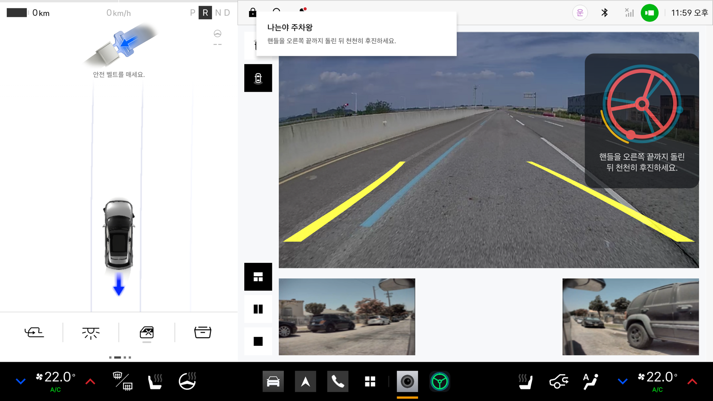 | 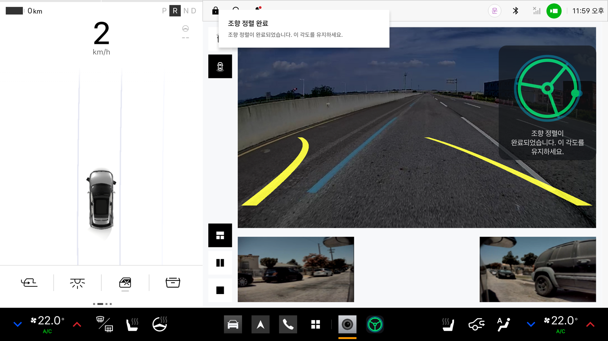 | 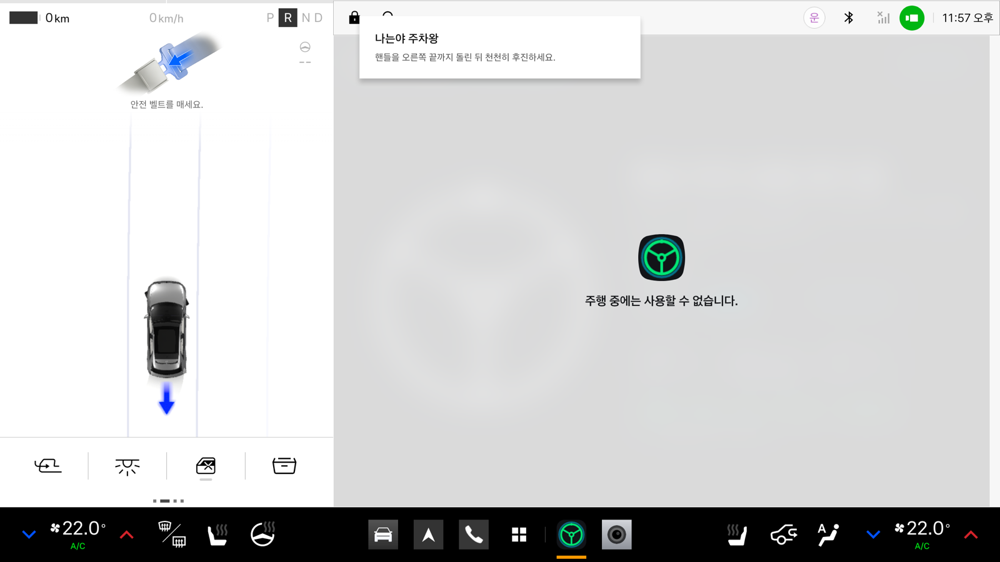 |
* **음성 우선**: 단계 전환 시 음성으로 안내해 시선은 거울과 후방 카메라에 두도록 합니다. Pleos Connect에서는 **Pleos TextToSpeech SDK(ON_DEVICE 모드)** 로, 그 외 기기에서는 Android TTS로 재생합니다. R 기어에서 시스템 후방 카메라 앱이 화면을 점유하므로 음성이 주 채널이고 링은 확인용입니다.
* UX 라이팅은 현대차그룹 3원칙(정확성·일관성·간결성)을 따릅니다. 모든 문구는 `app/src/main/res/values/strings.xml` 에 있습니다.

### 2.4 주차 이력과 세션 리플레이
* P 체결로 평가가 끝나면 세션(조향각·차속·기어·브레이크·도어 샘플)이 **차량 내부 저장소**에 자동 저장됩니다(최근 50건, 외부 전송 없음).
* 대기 화면의 **주차 이력** 버튼 → 기록 수·평균·최고 점수와 세션별 점수·등급·항목 막대·지표를 보여 줍니다.
* **다시 보기**는 저장된 신호를 별도 트래커로 다시 흘려 보내 같은 Ghost Ring 코칭 화면과 결과 카드를 재생합니다(1x/2x/4x, 일시정지). 운전자가 "그때 어디서 핸들을 늦게 풀었는지"를 눈으로 복기할 수 있고, 음성은 재생하지 않습니다.
* 이력·리플레이는 정차(P) 상태에서만 열리며, 주행 중 R 기어가 들어오면 자동으로 코칭 화면으로 돌아갑니다.

| 주차 이력 (Pleos 에뮬레이터) | 세션 리플레이 (Pleos 에뮬레이터) |
| :--: | :--: |
| 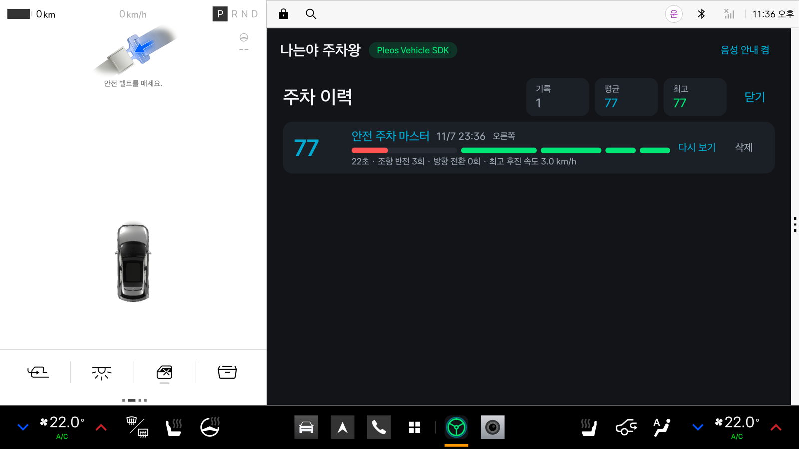 | 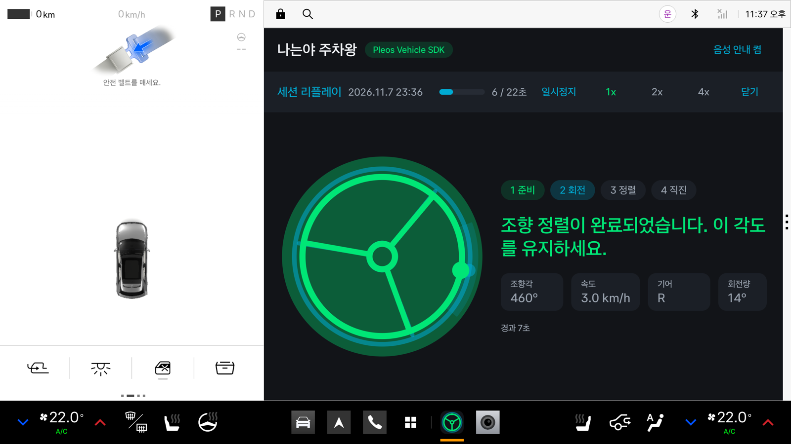 |

### 2.5 주차 위치 점수 (SVM 연동 확장, 구현 완료)
* 과정 점수에 더해 "어디에 세웠는가"를 보는 **위치 점수 100점**(주차선 안 30 · 좌우 균형 30 · 앞뒤 깊이 20 · 평행 정렬 20)을 구현했습니다. 종합 점수는 과정 70% + 위치 30%입니다.
* 입력은 SVM이 이미 계산하는 **인식 결과 숫자**(좌·우·앞·뒤 간격, 기울기, 신뢰도)이며 영상은 쓰지 않습니다. 현재 Pleos는 이 데이터를 제공하지 않으므로 운영 기본값은 "위치 점수 없음"이고, SVM이 공개되면 데이터 소스 하나만 연결하면 됩니다.
* 대기 화면의 **SVM 위치 점수 시연** 스위치(기본 꺼짐)를 켜면 고정 예시값으로 결과 화면·이력을 보여 줍니다. 화면과 이력에 항상 "가상 데이터"로 표시됩니다.
* 화면 주기 캡처 방식은 개인정보·매번 동의·화면 구성 의존성 때문에 검토 후 배제했습니다. 상세: [`docs/SVM_POSITION_SCORE.md`](docs/SVM_POSITION_SCORE.md)

| 시연 스위치 | 매끄러운 주차 (가상 데이터) | 망설인 주차 (가상 데이터) |
| :--: | :--: | :--: |
| 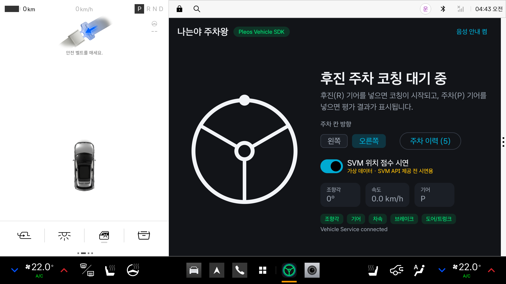 | 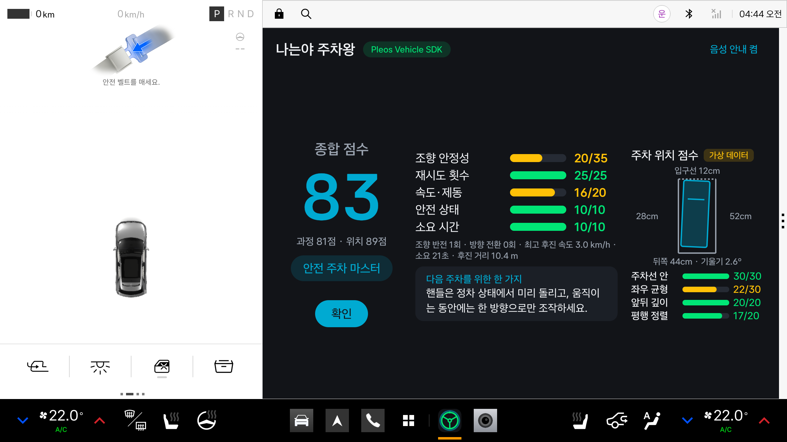 | 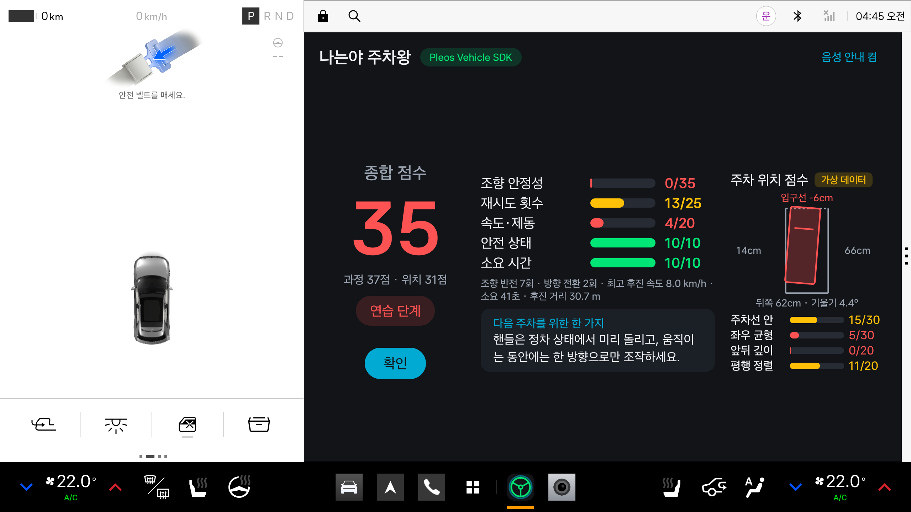 |

### 2.6 어디서나 시연 가능
* **Pleos Connect AVD / 실차**: Vehicle Service가 감지되면 자동으로 Vehicle SDK 경로를 사용합니다. Virtual Console의 Motion(기어·브레이크·조향각)·Convenience(트렁크) 카드로 신호를 넣을 수 있습니다.
* **그 외 모든 Android 기기/에뮬레이터**: Vehicle Service가 없으면 내장 시뮬레이터로 전환됩니다. "모범 주차", "초보 주차" 시나리오 재생과 수동 슬라이더를 제공하므로 동일한 데모 스크립트를 재현할 수 있습니다.

---

## 2.7 화면 (시뮬레이션 모드, 일반 에뮬레이터 캡처)

| 대기 | 코칭 (Snap-In) | 결과 |
| :--: | :--: | :--: |
| 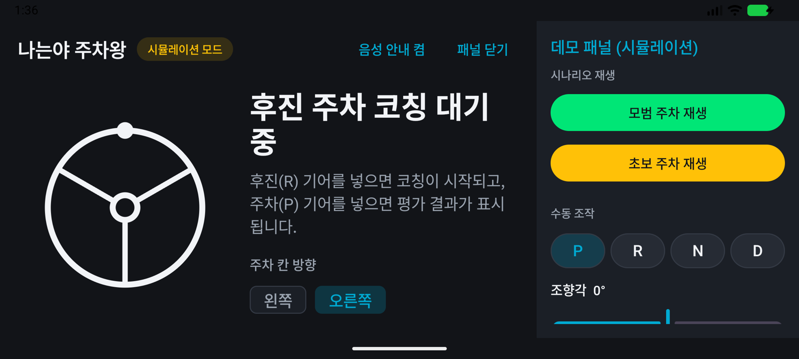 | 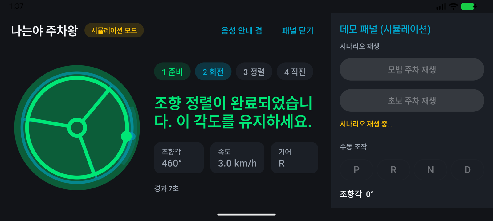 | 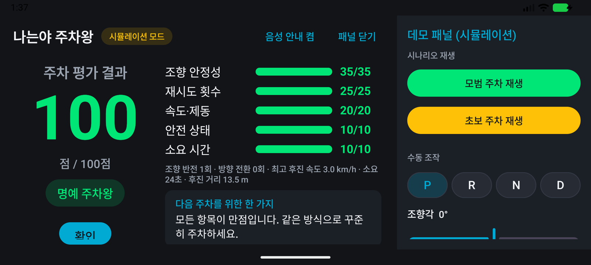 |

| 정렬 단계 (잔상 링이 중앙으로) | 초보 시나리오 (과속 경고) | 초보 결과 (항목별 감점·코칭) |
| :--: | :--: | :--: |
|  |  | 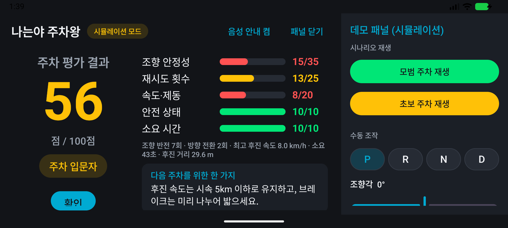 |

---

## 3. Pleos SDK / API 사용 명세

| 신호 | 경로 | API |
| :-- | :-- | :-- |
| 조향각 | Vehicle SDK `SteeringWheel` | `checkSteeringWheelAngleCapabilities` → `getCurrentSteeringWheelAngle` / `registerSteeringWheelAngle` |
| 기어 | Vehicle SDK `Gear` (실패 시 AAOS `GEAR_SELECTION` 폴백) | `getCurrentGearSelectionState` / `registerGearSelection` |
| 브레이크 페달 | Vehicle SDK `Brake` | `checkBrakePedalStatusCapabilities` → `registerBrakePedalStatus` |
| 도어/트렁크 | Vehicle SDK `Door` | `checkDoorPositionCapabilities` → `registerDoorPosition(DoorArea(REAR …))` |
| 차속 | AAOS `CarPropertyManager` | `PERF_VEHICLE_SPEED` (Pleos 공식 FAQ가 안내하는 클러스터 동일 소스) |
| 주행 제한 | AAOS `CarUxRestrictionsManager` | `onUxRestrictionsChanged` |
| 카메라 위 배너 | Android Notification (IMPORTANCE_HIGH, CATEGORY_NAVIGATION) | `CoachNotifier` — 액티비티가 전면이 아닐 때만 |
| 음성 안내 | Pleos TextToSpeech SDK 3.3.1 | `TextToSpeech(context, Mode.ON_DEVICE).initialize` → `setLocale(KOREA)` → `speak` |

권한: `pleos.car.permission.CAR_DRIVE`, `CAR_DOORS`, `CAR_SAFETY`, `CAR_INFO`, `TTS_SERVICE`, `android.car.permission.CAR_SPEED`(런타임), `CAR_POWERTRAIN`. (`READ_CAR_STEERING`·`CAR_SPEED`는 선언만 되어 있고 현재 이미지에는 정의되지 않은 권한으로 확인됨)

의존성: `ai.pleos.playground:Vehicle:2.3.2`, `ai.pleos.playground:TextToSpeech:3.3.1` (`https://nexus-playground.pleos.ai/repository/maven-releases/`).

---

## 4. 실행 방법

### 4.1 APK 설치 (심사용)
```bash
# Pleos Connect AVD(Pleos_Connect_v2.1) 또는 임의의 Android 기기/에뮬레이터(API 28+)
adb install -r apk/6학년5반_나는야주차왕_release.apk
adb shell am start -n com.steerin.parkingmaster/.presentation.MainActivity
```
* Pleos AVD에서 처음 실행하면 차량 데이터 권한 요청 창이 뜹니다. 허용 후 상단 칩이 **"Pleos Vehicle SDK"** 로 바뀝니다.
* Virtual Console → Motion 카드에서 기어를 **R** 로 바꾸면 코칭이 시작되고, **P** 로 바꾸면 결과 카드가 표시됩니다.
* Vehicle Service가 없는 기기에서는 상단 칩이 **"시뮬레이션 모드"** 로 표시되고 우측 데모 패널이 열립니다. **"모범 주차 재생"** 을 누르면 24초 뒤 결과 카드까지 자동 진행됩니다.

### 4.2 Pleos Connect 에뮬레이터에서 실행 (실측 완료)
```bash
scripts/pleos_avd.sh install   # 공식 가이드대로 Update Site 등록 → 시스템 이미지 설치 → AVD 생성 (RAM 4 GB, Cold boot)
scripts/pleos_avd.sh start     # Pleos_Connect_v2.1 기동 (Android Studio Device Manager에도 표시됨)
scripts/pleos_avd.sh deploy    # 디버그 빌드 설치·실행
adb forward tcp:8088 tcp:8088  # 브라우저에서 http://127.0.0.1:8088/ → Virtual Console
```
* Virtual Console → Emulation Controls → **Motion**(Gear Selection, Brake Pedal, Steering Angle)으로 R→주행→P 흐름을 만들면 코칭·채점이 동작합니다. 속도는 정수 km/h만 받습니다.
* 실측 사실: R 기어에서는 시스템 후방 카메라 앱이 앱 영역을 점유하고 P에서 자동 복귀합니다(결과 카드는 P에서 표시). 조향각은 콘솔 기준 부호가 반대라 앱에서 정규화했습니다.
* 시연 영상(에뮬레이터 화면 녹화): [`docs/video/pleos_connect_model_parking.mp4`](docs/video/pleos_connect_model_parking.mp4)

### 4.3 소스 빌드
```bash
git clone https://github.com/skyworker104/pleos-steerin.git
cd pleos-steerin
./gradlew :app:testDebugUnitTest     # 채점 엔진·운동학 모델·상태 머신 단위 테스트
./gradlew :app:assembleRelease       # signing/signing.properties 가 있으면 서명본, 없으면 unsigned
```

### 4.4 테스트 환경
| 항목 | 버전 |
| :-- | :-- |
| JDK | 17 |
| Gradle / AGP / Kotlin | 8.10.2 / 8.8.2 / 2.0.21 (Pleos 공식 샘플 앱 기준선과 동일) |
| compileSdk / minSdk | 35 / 28 |
| Pleos Vehicle SDK | 2.3.2 (Vehicle Service 2.3.13 이상) |
| 검증 환경 | Pleos Connect 에뮬레이터 `Pleos_Connect_v2.1`(Android 14, Vehicle Service 2.3.22, CaaS 4.2.10) · 일반 Android 에뮬레이터(API 37, 시뮬레이션 모드) |

---

## 5. 프로젝트 구조

```
app/src/main/java/com/steerin/parkingmaster/
 ├── data/outcome/ParkingOutcomeSource.kt   # 주차 위치 데이터 소스 (SVM 자리 · 미제공 · 시연용)
 ├── data/session/SessionRepository.kt      # 세션 파일 저장소 (filesDir/sessions)
 ├── data/vehicle/
 │    ├── VehicleSignal.kt                 # 정규화된 신호 모델
 │    ├── VehicleSignalSource.kt           # 데이터 소스 인터페이스
 │    ├── PleosVehicleSignalSource.kt      # Pleos Vehicle SDK 연동 (조향각·기어·브레이크·도어)
 │    ├── AaosCarSignalSource.kt           # AAOS CarPropertyManager (차속, 기어 폴백)
 │    └── SimulatedVehicleSignalSource.kt  # 시나리오 재생기 / 수동 시뮬레이터
 ├── domain/
 │    ├── kinematics/BicycleModel.kt       # 운동학 자전거 모델 (상대 방위각 추정)
 │    ├── coaching/GhostTargetPlanner.kt   # 단계별 목표 조향각 (READY→TURN_IN→STRAIGHTEN→HOLD)
 │    ├── scoring/ParkingScoreEvaluator.kt # 100점 과정 채점 엔진
 │    ├── outcome/  SlotObservation · SlotOutcomeEvaluator  # 위치 점수·종합 점수
 │    └── session/  ParkingSessionTracker(R→P 세션·상태 머신) · SessionCodec(텍스트 저장 포맷) · SessionReplayer
 └── presentation/
      ├── ParkingViewModel.kt / ReplayController.kt / MainActivity.kt
      ├── ui/  GhostRing · CoachingScreen · ResultScreen · StandbyScreen · HistoryScreen · ReplayScreen · DemoPanel
      ├── overlay/  CoachNotifier(헤즈업 알림) · GhostOverlayWindow(디버그 실험)
      ├── ux/UxRestrictionsMonitor.kt      # CarUxRestrictions 연동
      └── voice/  VoiceCoach · PleosTtsEngine   # Pleos TTS SDK(ON_DEVICE) / Android TTS 폴백 + Snap-In 확인음
app/src/test/…                             # 단위 테스트 33건 (채점·위치 채점·모델·플래너·세션·코덱/리플레이)
docs/                                      # SCORING.md, DEMO_SCRIPT.md, SVM_POSITION_SCORE.md, PT_SVM_ADDENDUM.md, 분석 보고서
apk/                                       # 제출용 release APK
```

---

## 6. 로드맵

* **지금 (공모전 제출본)**: 위 기능 전체. 12.3인치 와이드 레이아웃, 시뮬레이션 모드 포함.
* **SVM 공개 시**: 위치 점수 활성화(구현 완료, 데이터 소스 연결만 필요), 실시간 위치 기반 음성 코칭.
* **PT 이후**: CarInfo 제원 기반 축거 자동 보정, 배지·목표 점수 설정, 실차에서 조향각 부호·콜백 주기 재확인.
* **상용화 검토 단계**: 블루멤버스 포인트·정비 쿠폰·UBI 보험 연계는 **제휴가 전제된 로드맵** 입니다. 본 제출본은 앱 내 등급·배지까지만 구현하며, 운전 데이터의 외부 제공은 별도의 명시적 동의 설계가 필요합니다.

## 7. 라이선스 / 고지
* 소스: MIT. Pleos Vehicle SDK는 Pleos Playground 이용 약관을 따릅니다.
* release 서명 키는 저장소에 포함하지 않습니다. 재빌드 방법과 제출 APK의 인증서 지문은 `signing/README.md` 에 있습니다.
