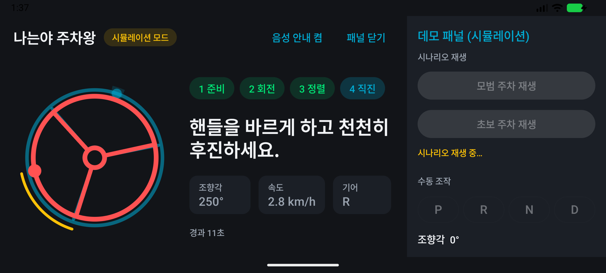
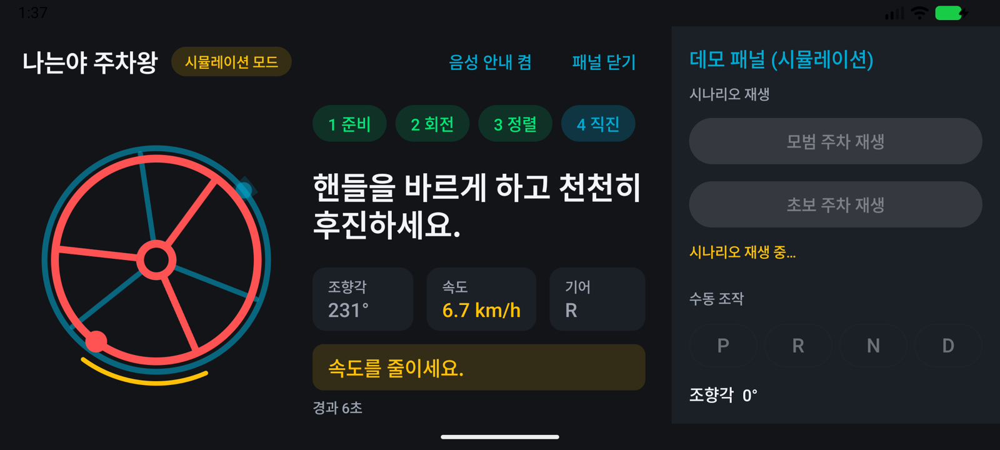

# 나는야 주차왕 (pleos-steerin)

> **후진 주차 과정을 차량 신호로 채점하고, Ghost Ring Snap-In 가이드로 코칭하는 Pleos Connect 앱**
> 현대자동차그룹 차량용 앱 개발 공모전 2026 출품작 · 일반인 부문 · Pleos Connect(Android Automotive OS) 앱

| 항목 | 내용 |
| :-- | :-- |
| 앱 이름 | 나는야 주차왕 (Parking Master) |
| 한 줄 소개 | R 기어를 넣는 순간부터 P 기어까지, 조향각·기어·차속·브레이크·도어 신호로 주차 과정을 100점 채점하고 목표 조향각을 "잔상 링"으로 보여 주는 후진 주차 코치 |
| 플랫폼 | Pleos Connect (Android Automotive OS, API 28+) · Pleos Vehicle SDK 2.3.2 · Kotlin · Jetpack Compose |
| 데이터 경로 | **온디바이스** Vehicle SDK + AAOS Car API. 클라우드 API, GPS, 카메라, 초음파 센서를 사용하지 않습니다. |
| APK | [`apk/pleos-steerin_ParkingMaster_release.apk`](apk/) (release 서명본, 아래 "실행 방법" 참고) |

---

## 1. 왜 만들었나

후진 주차는 초보 운전자가 가장 자주 실패하고 가장 오래 걱정하는 조작입니다. 기존 주차 보조는 경고음과 카메라로 **"지금 위험하다"** 만 알려 주고, 운전자가 **무엇을 어떻게 고쳐야 하는지** 는 말해 주지 않습니다. 또한 스마트폰 앱은 핸들이 얼마나 돌아가 있는지 알 수 없으므로 이 문제를 풀 수 없습니다.

Pleos Connect 앱은 다릅니다. 차량이 이미 알고 있는 **조향각, 기어, 차속, 브레이크, 도어 상태** 를 실시간으로 읽을 수 있으므로,

1. 주차 **과정의 품질** (급조향, 재시도, 과속, 급제동, 안전 상태, 소요 시간)을 객관적으로 채점하고
2. 다음 순간 핸들을 어디에 둬야 하는지 **목표 조향각을 시각적으로 포개는(Snap-In)** 방식으로 코칭할 수 있습니다.

숫자("15도 더 돌리세요")가 아니라 **"회색 링을 녹색 링에 맞추세요"** 라는 한 가지 행동만 요구하는 것이 핵심 UX입니다.

---

## 2. 주요 기능

### 2.1 Ghost Steering Guide (잔상 링 Snap-In)
* 화면에 **목표 조향각의 잔상 링(Pleos Cyan)** 과 **현재 핸들(흰색/코랄)** 을 1:1 각도로 그립니다.
* 두 링이 허용 오차 안에서 포개지면 현재 핸들이 **녹색** 으로 바뀌고 짧은 확인음이 납니다.
* 목표 조향각은 **운동학 자전거 모델** 로 계산합니다. 조향각과 차속을 적분해 "차가 얼마나 회전했는가"를 추정하고, 직각 후진 주차 표준 절차(풀 록 → 65° 회전 시 풀기 시작 → 80° 또는 핸들을 바로 세운 시점에 직진)에 따라 단계별 목표각을 냅니다. 절대 위치가 아니라 **상대 회전량** 을 쓰므로 GPS나 주차 칸 정보가 필요 없습니다.

### 2.2 100점 주차 과정 평가
모든 항목이 실제로 수신 가능한 신호 위에 있습니다. 상세 수식은 [`docs/SCORING.md`](docs/SCORING.md).

| 항목 | 배점 | 신호 | 측정 |
| :-- | :--: | :-- | :-- |
| 조향 안정성 | 35 | 조향각 | 조향 방향 반전 횟수(1회 무료), 이동 중 최대 조향 각속도 |
| 재시도 횟수 | 25 | 기어 | R↔D 전환 횟수 |
| 속도·제동 | 20 | 차속, 브레이크 | R 기어 최고 속도(5 km/h 초과분), 급제동 횟수 |
| 안전 상태 | 10 | 도어/트렁크 | 후진 중 열림 감지 시 0점 |
| 소요 시간 | 10 | 기어 타임스탬프 | 첫 R → P 체결, 45초 초과분 |

결과 카드는 **P 기어 체결 후에만** 표시되며, 가장 많이 감점된 항목에 대한 한 줄 코칭을 함께 보여 줍니다.

### 2.3 Driving UX / 안전
* 상태 머신: `DRIVING`(최소 UI, 터치 없음) → `COACHING`(링 + 한 줄 지시, 읽기 전용) → `RESULT`(P 체결 시에만, 터치 허용).
* `CarUxRestrictionsManager` 를 구독해 주행 제한 상태에서는 데모 패널과 보조 텍스트를 숨깁니다.
* **음성 우선**: 단계 전환 시 TTS로 안내해 시선은 거울과 후방 카메라에 두도록 합니다. 링은 확인용입니다.
* UX 라이팅은 현대차그룹 3원칙(정확성·일관성·간결성)을 따릅니다. 모든 문구는 `app/src/main/res/values/strings.xml` 에 있습니다.

### 2.4 어디서나 시연 가능
* **Pleos Connect AVD / 실차**: Vehicle Service가 감지되면 자동으로 Vehicle SDK 경로를 사용합니다. Virtual Console의 Motion(기어·브레이크·조향각)·Convenience(트렁크) 카드로 신호를 넣을 수 있습니다.
* **그 외 모든 Android 기기/에뮬레이터**: Vehicle Service가 없으면 내장 시뮬레이터로 전환됩니다. "모범 주차", "초보 주차" 시나리오 재생과 수동 슬라이더를 제공하므로 동일한 데모 스크립트를 재현할 수 있습니다.

---

## 2.5 화면 (시뮬레이션 모드, 일반 에뮬레이터 캡처)

| 대기 | 코칭 (Snap-In) | 결과 |
| :--: | :--: | :--: |
|  |  |  |

| 정렬 단계 (잔상 링이 중앙으로) | 초보 시나리오 (과속 경고) | 초보 결과 (항목별 감점·코칭) |
| :--: | :--: | :--: |
|  |  |  |

---

## 3. Pleos SDK / API 사용 명세

| 신호 | 경로 | API |
| :-- | :-- | :-- |
| 조향각 | Vehicle SDK `SteeringWheel` | `checkSteeringWheelAngleCapabilities` → `getCurrentSteeringWheelAngle` / `registerSteeringWheelAngle` |
| 기어 | Vehicle SDK `Gear` (실패 시 AAOS `GEAR_SELECTION` 폴백) | `getCurrentGearSelectionState` / `registerGearSelection` |
| 브레이크 페달 | Vehicle SDK `Brake` | `checkBrakePedalStatusCapabilities` → `registerBrakePedalStatus` |
| 도어/트렁크 | Vehicle SDK `Door` | `checkDoorPositionCapabilities` → `registerDoorPosition(DoorArea(REAR …))` |
| 차속 | AAOS `CarPropertyManager` | `PERF_VEHICLE_SPEED` (Pleos 공식 FAQ가 안내하는 클러스터 동일 소스) |
| 주행 제한 | AAOS `CarUxRestrictionsManager` | `onUxRestrictionsChanged` |

권한: `pleos.car.permission.READ_CAR_STEERING`, `CAR_DRIVE`, `CAR_DOORS`, `CAR_SAFETY`, `CAR_SPEED`, `CAR_INFO`, `android.car.permission.CAR_SPEED` (런타임 요청).

의존성: `ai.pleos.playground:Vehicle:2.3.2` (`https://nexus-playground.pleos.ai/repository/maven-releases/`).

---

## 4. 실행 방법

### 4.1 APK 설치 (심사용)
```bash
# Pleos Connect AVD(Pleos_Connect_v2.1) 또는 임의의 Android 기기/에뮬레이터(API 28+)
adb install -r apk/pleos-steerin_ParkingMaster_release.apk
adb shell am start -n com.steerin.parkingmaster/.presentation.MainActivity
```
* Pleos AVD에서 처음 실행하면 차량 데이터 권한 요청 창이 뜹니다. 허용 후 상단 칩이 **"Pleos Vehicle SDK"** 로 바뀝니다.
* Virtual Console → Motion 카드에서 기어를 **R** 로 바꾸면 코칭이 시작되고, **P** 로 바꾸면 결과 카드가 표시됩니다.
* Vehicle Service가 없는 기기에서는 상단 칩이 **"시뮬레이션 모드"** 로 표시되고 우측 데모 패널이 열립니다. **"모범 주차 재생"** 을 누르면 24초 뒤 결과 카드까지 자동 진행됩니다.

### 4.2 소스 빌드
```bash
git clone https://github.com/skyworker104/pleos-steerin.git
cd pleos-steerin
./gradlew :app:testDebugUnitTest     # 채점 엔진·운동학 모델·상태 머신 단위 테스트
./gradlew :app:assembleRelease       # signing/signing.properties 가 있으면 서명본, 없으면 unsigned
```

### 4.3 테스트 환경
| 항목 | 버전 |
| :-- | :-- |
| JDK | 17 |
| Gradle / AGP / Kotlin | 8.10.2 / 8.8.2 / 2.0.21 (Pleos 공식 샘플 앱 기준선과 동일) |
| compileSdk / minSdk | 35 / 28 |
| Pleos Vehicle SDK | 2.3.2 (Vehicle Service 2.3.13 이상) |
| 검증 환경 | Pleos Connect 에뮬레이터 `Pleos_Connect_v2.1`(Android 14) · 일반 Android 에뮬레이터(API 37, 시뮬레이션 모드) |

---

## 5. 프로젝트 구조

```
app/src/main/java/com/steerin/parkingmaster/
 ├── data/vehicle/
 │    ├── VehicleSignal.kt                 # 정규화된 신호 모델
 │    ├── VehicleSignalSource.kt           # 데이터 소스 인터페이스
 │    ├── PleosVehicleSignalSource.kt      # Pleos Vehicle SDK 연동 (조향각·기어·브레이크·도어)
 │    ├── AaosCarSignalSource.kt           # AAOS CarPropertyManager (차속, 기어 폴백)
 │    └── SimulatedVehicleSignalSource.kt  # 시나리오 재생기 / 수동 시뮬레이터
 ├── domain/
 │    ├── kinematics/BicycleModel.kt       # 운동학 자전거 모델 (상대 방위각 추정)
 │    ├── coaching/GhostTargetPlanner.kt   # 단계별 목표 조향각 (READY→TURN_IN→STRAIGHTEN→HOLD)
 │    ├── scoring/ParkingScoreEvaluator.kt # 100점 과정 채점 엔진
 │    └── session/ParkingSessionTracker.kt # R→P 세션 기록 + Driving 상태 머신
 └── presentation/
      ├── ParkingViewModel.kt / MainActivity.kt
      ├── ui/  GhostRing · CoachingScreen · ResultScreen · StandbyScreen · DemoPanel
      ├── ux/UxRestrictionsMonitor.kt      # CarUxRestrictions 연동
      └── voice/VoiceCoach.kt              # TTS 안내 + Snap-In 확인음
app/src/test/…                             # 단위 테스트 4종 (채점·모델·플래너·세션)
docs/                                      # SCORING.md, DEMO_SCRIPT.md, 분석 보고서
apk/                                       # 제출용 release APK
```

---

## 6. 로드맵

* **지금 (공모전 제출본)**: 위 기능 전체. 12.3인치 와이드 레이아웃, 시뮬레이션 모드 포함.
* **PT 이후**: Pleos TextToSpeech SDK로 음성 교체, CarInfo 제원 기반 축거 자동 보정, 세션 로그 저장·리플레이, 주차 이력과 배지.
* **상용화 검토 단계**: 블루멤버스 포인트·정비 쿠폰·UBI 보험 연계는 **제휴가 전제된 로드맵** 입니다. 본 제출본은 앱 내 등급·배지까지만 구현하며, 운전 데이터의 외부 제공은 별도의 명시적 동의 설계가 필요합니다.

## 7. 라이선스 / 고지
* 소스: MIT. Pleos Vehicle SDK는 Pleos Playground 이용 약관을 따릅니다.
* release 서명 키는 저장소에 포함하지 않습니다. 재빌드 방법과 제출 APK의 인증서 지문은 `signing/README.md` 에 있습니다.
